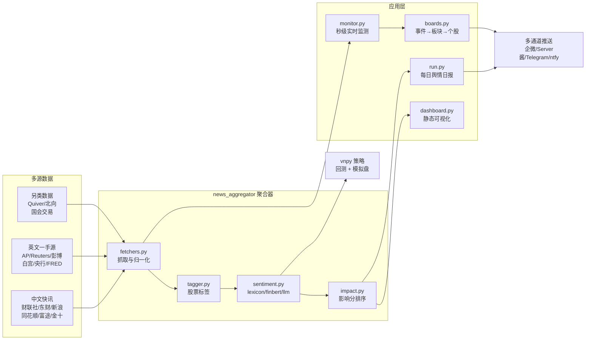

# FlashQuant 技术架构

> 本文记录项目的完整技术细节。原项目：[pipi-520/FlashQuant](https://github.com/pipi-520/FlashQuant)（MIT License）。

## 一、架构总览



## 二、核心模块

### 2.1 多源抓取（`news_aggregator/fetchers.py`）

- 归一化字段：`id, ts, date, source, title, content, url, symbols, lang, kind, ticker, politician`
- 每源独立容错：单源失败/超时不影响整体；抓取走 akshare 封装的公开端点 + Google News RSS + 官方 RSS/JSON
- 免 key 为主：仅 Quiver / Bargo / Congress / FRED（可选）/ Finnhub（回填用）需要注册，缺 key 自动跳过或降级
- 政策公告源：gov.cn 已下线 RSS，现用列表页 AJAX 数据端点 `zhengce/zuixin/ZUIXINZHENGCE.json`（旧 RSS 保留为回退）

### 2.2 情绪引擎（`news_aggregator/sentiment.py`）

可插拔后端，统一入口 `score_text` / `score_batch`，失败自动回退词典：

| 后端 | 说明 |
|---|---|
| `lexicon` | 离线中英双语词典，含否定窗口处理（`不会/没有/not/never` 等），零依赖永远可用 |
| `finbert` | `yiyanghkust/finbert-tone`，transformers 惰性加载 |
| `llm` | OpenAI 兼容 chat/completions，结构化 JSON 输出 |

中文打分实际走的是自研词典 `zh-v2.1`（`score_text_zh`），不是复旦/第三方方案——两个仓库里都没有 Fudan 情绪实现。2026-11-09 又给中文打分加了一道**行情综述剥离**：`score_text_zh` 在给正文打分前先按句切分，丢掉「指数名 + 涨跌幅 / 报 xxxx 点 / 集体上涨 / 成交额 xx 亿」这类纯盘面复述句（`strip_market_wrap`）。起因是 15:06 那轮「中际旭创成交额167.40亿元，位居A股第一」：标题单独打分 0.0，正文里「主要指数集体上涨」加四个「涨0.x%」把它推到 +0.83，于是被当成个股利好推送——那只是复述大盘涨了。剥离后该条 0.0，不再入选；标题行原本就不受这道处理影响。

换后端的尝试有实测记录（`scripts/sentiment_ab_eval.py`，2026-11-09，Pi CPU）：自有 120 条人工标注上词典 acc .808 / 方向 .987（n=78，词典在这批数据上调过，偏乐观），中文金融 BERT `hw2942` acc .567 / 方向 .939（n=49，55.8% 判中性，丢信号）；FinFE test（复旦 BBT-Fin/CFLEB 社媒三分类，1000 条）上词典 acc .420 / macroF1 .394，BERT acc .500 / macroF1 .504，多数类基线是 .462，两者都弱。BERT 约 110–118ms/条（一轮 120 条 ≈ 13s）。复旦论文里 80.24% 属于 BBT-FinT5-large，权重没有公开，公开代理模型达不到；所以暂不换后端，除非后续在 GPU 上用 FinFE train（15k）自己微调并证明能迁移到快讯/公告文体。

### 2.3 影响分模型（`news_aggregator/impact.py`）

```
impact = w_authority × 来源权威度      # 央行/政府 1.0 → 通讯社 0.85 → 快讯 0.7~0.8
       + w_burst     × 爆发系数        # 60 分钟窗内多源相似报道计数（经校准权重降至 0.05）
       + w_intensity × 情绪强度 |score|
       + w_relevance × 标的相关度      # 有具体标的 1.0 / 无 0.2（校准后上调至 0.30）
       + w_theme     × 主题热度        # themes.yaml 中的主题权重
```

权重经 2026-08-24 校准（36939 条新闻，见 `scripts/impact_calibration.py`）：burst 对次日波动无预测力，故降权；有具体标的的新闻次日波动显著更大，故 relevance 上调。

### 2.4 事件监测（`news_aggregator/monitor.py`）

并发抓取（线程池软超时）→ id 去重（`news/seen.json`，有界 2 万条 + 原子写入）→ 情绪打分 → 事件词匹配（`themes.yaml`）→ 影响分/情绪地板过滤（`impact_min` / `score_min`）→ **注意力预算**（`news_aggregator/alert_filter.py`）→ 板块/个股映射（AKShare 概念板块，失败降级）→ 多通道告警。只告警不下单。香橙派上由 cron 以 `--once` 单轮驱动（`scripts/cron_monitor.sh`），也支持 `poll_interval` 常驻轮询。

注意力预算（2026-11-08）针对的是「过阈值的告警太多」而不是「阈值太低」：历史 104 轮实测均值 168.7 条告警/轮（早间积压轮 max 451），impact 中位 0.578 且 100% 紧贴旧阈值 0.45——调阈值没有区分度，缺的是按影响分取头部。筛选顺序：轮内同题聚类 → 跨轮冷却（`news/alert_state.json`，12h）→ 每主题配额 → 按 impact 取 top-N；个股影响映射的 LLM 调用只对入选条目发生（原先对全部候选调用）。同题判定用归一化标题的字符二元组 Jaccard ≥ 0.80 或字面子串包含（短标题需 ≥12 字），并要求两边数字串互为子集，防止模板化标题误并；不使用二元组重叠系数（英文归一化去空格后类型饱和，会把不相干长英文并到一起，误并方向是漏报）。104 轮全量回放：告警 17541→1472 条、企微消息 771→104 条（每轮恰好 1 条，单条最大 2871 字节），抑制构成 = 阈值 1718 / 轮内同题 967 / 跨轮冷却 26 / 主题配额 8412 / 注意力预算 4946，被预算挤掉的 impact≥p90(0.66) 条目 4 条，入选告警 impact 中位数 0.578→0.659。2026-11-09 香橙派 `--once --dry-run` 实测：新增 983 → 过阈值 198 → 推送 15，企微消息 1 条 / 3319 字节。

摘要格式（2026-11-09 二版，分组）：抬头依次是热词榜（文本版词云，`算力9 · 回购6`，频次即权重）、主线（主题×条数，按条数降序）、多空统计、抑制构成；正文按主题分组、组内按影响分降序，单行 `· 标题｜影响分 · 情绪分 · 事件类型 · 来源 · ×N源`，其中 `×N源` 是轮内同题源数（多源互证＝重要性的客观信号）。主题分组是切块的最小单位，即使整组超预算也不把组标题和条目拆到两条消息里。多空方向优先取事件分类，未命中时回落到情绪分符号（实测 15 条里 11 条没有事件类型，否则全记「中性」）。同日 dry-run：新增 1008 → 过阈值 190 → 推送 15，抑制 = 同题 14 / 配额 33 / 预算 128，企微 1 条 / 3063 字节。cron 以 `git pull --ff-only` 的退出码为准，拉取失败即中止本轮（不再静默跑旧代码），并在日志里打印本次运行的 commit。

摘要格式（2026-11-09 三版，瘦身）：用户看 11:36 那轮仍反馈手机上「比较乱、抓不到重点」，改动全部先量化再落地（候选=该轮 `alerts.jsonl` 的行，标题/正文从 `news/raw` 复原后重跑筛选与渲染）：① `max_alerts_per_round` 15→8、`digest_top_detail` 3→0（板块涨幅明细是把正文噪声搬进摘要），同轮回放 2959→1605 字节、1 条消息；② 标题截断改语义断句（`clip_title`：句末标点 → 子句边界 → 闭合括号 → 才硬切加 `…`），不再出现把「涨超3%」切半的行；③ 分组主题按「标题命中词数」优先（`order_themes_by_title`；39.0% 的推送条目其组主题关键词在标题里一个都没有，标题优先会改变 8.6% 的归属），治的是「军工电子板块走高，铖昌科技涨停」被正文里的「成交额」分到券商/金融；④ 同题判定新增事件主干前缀规则（`core_title` 切掉「涨超/下跌超/成交额/ETF/截至/标的指数/句末标点」这类盘面尾巴后取归一化公共前缀，需 ≥12 字且占较短主干 ≥0.6，数字护栏只看主干数字；全标题数字护栏不再先返回，否则尾部涨幅会把第 5 步挡死），近 3 天 11.4 万个 12h 窗口候选对里增量只有 2 对，且都是真转述（苹果 HALO 两条、美国原油库存两条），Meta/Nvidia 那类同栏位英文稿靠 0.6 比例项仍不并；⑤ 新增 `macro_reserve`（默认 2）：预算收到 8 后回放暴露纯按影响分取头部会吃掉宏观消息——近 3 天两轮 58 条宏主题候选在 8/10/12 三档下存活 0 条（关税暂停、10 月 CPI/PPI 名次常年在 16~62），故先按影响分预留宏主题名额、余下预算自动回到全池，预留候选同样要过同题去重与冷却，`0=关闭`。已知残留：改写式通稿仍会并列（同一条关税公告两条、印度加息两条），根因是主题标签误挂（中国 CPI、印度加息都落到「美联储利率」组）加主干公共前缀被时间状语打断，归到事件类型/主题标签那条待办。

摘要格式（2026-11-09 四版，15:06 反馈）：三条独立改动，都用 15:06 那轮的真实告警（120 条过阈值候选）回放验证。① **词云配额与列表配额解耦**：热词改为对全部过阈值候选计数（不再只数入选条目），`digest_top_keywords` 8→14；列表预算 `max_alerts_per_round` 8→10。同题判定**不放宽**——用户问「同主题能不能留 3 条」，`max_per_theme` 本来就是 3，被挤掉的是「同一件事的不同报道」而不是同主题，放宽同题等于让两条改写通稿并列，所以只扩预算、不动阈值。回放 10 条 / 6 主题、文本 2273 字节，仍是一条企微消息。② **行情综述不计情绪**（见 2.2 的 `strip_market_wrap`）：中际旭创那条正文贡献 +0.83、标题 0.0，剥离盘面复述句后 0.0，不再入选。③ **资金面标签**：新增 `news_aggregator/fundflow.py`，调 akshare `stock_individual_fund_flow_rank(indicator="今日")`（单次约 20 秒、5300 行）取主力净流入，只给「标题里恰好点名一只非泛称 A 股」的入选条目加标签，插在情绪分之后（`主力+6.7亿(涨+0.9%)` / `主力-2314万(涨+0.3%)`）；网络或榜单失败静默无标签、不阻塞推送，超时由 `fund_flow_timeout` 控制；泛称股票名（机器人 300024、老百姓 603883）不参与匹配，避免把「机器人零部件…恒而达回应」挂到 300024 上。④ **文本摘要标题变 markdown 超链接**（`[标题](url)`，空格与圆括号百分号转义），点开即读原文。⑤ **图文去重**：图片卡片发送成功时，文本摘要抬头收成一行（`compact_header` 只留轮次+条数），热词/主线/多空/抑制只画在图片上——同一屏读两遍同样的统计没有意义；图片失败时仍发完整抬头。回放实测：资金面四只（耐普矿机 +484万、步科股份 +273万、恒而达 −103万、中国长城 −2314万）全部对得上，马斯克那条因命中泛称「机器人」而无标签。

富媒体图片卡片（2026-11-09，`news_aggregator/card.py`）：文本摘要能复制能检索但手机上扫不出重点，于是把**同一批入选告警**再渲染成一张 PNG，走独立的 `msgtype=image` 消息（企微群机器人的 markdown 不能内嵌图片，base64+md5 官方限 2MB）。实现只依赖 Pillow，不引入 wordcloud/matplotlib：词云是自写的阿基米德螺线 + 矩形碰撞检测（词频→字号用 0.55 幂律压缩，否则最高频词独占整行；条带高度随词数收缩 `max(150, min(360, 96+33n))`，稀疏轮不留大片空白），折行是自写的按像素折行（`units()` 把英文数字串切成整块、CJK 逐字、空白折成一个空格单位——空格必须保留，否则拼出来的主线行会粘成「财报/公告×1创新药/疫苗×1」）。版面自上而下：抬头（轮次精简成 `11-09 11:36` + 推送/过阈值/新增）→ 主线 → 多空（利好红/利空绿）→ 词云 → 按主题分组条目（标题不截断、折行最多两行，指标行 `影响 · 情绪 · 资金面 · 事件类型 · 来源 · ×N源`）→ 抑制构成页脚。降级路径是硬要求：字体探测失败（挑 ttc 里的 SC 字面，跳过 Mono）或图片超 `max_bytes` 直接抛错/跳过，由 monitor 只发文本，绝不发方框图；`rich_card.also_send_text` 默认 true，图片够用后置 false 一轮只一条消息。香橙派侧 `pillow==13.0.0`（uv 装进 `~/.venvs/flashquant`）+ 系统 `fonts-noto-cjk`。实测：15:06 那轮按四版规则回放 10 条 / 6 主题 / 14 个热词 → 1080×1960、402337 字节；11:36 那轮真实告警回放 8 条 / 6 主题 → 1080×1912、396261 字节；稀疏轮 2 条 → 1080×874、135556 字节，均在 1.9MB 上限内。渲染与排布的单测在 `tests/test_alert_card.py`（纯计算部分用 `measure` 回调离线跑，不依赖 Pillow；渲染用例缺 Pillow 或字体即 skip），全量 132 passed / 1 skipped。已知残留与文本摘要相同：改写式通稿仍并列（关税公告两条），根因是主题标签误挂，归 #14 待办。

### 2.5 静态 Dashboard（`news_aggregator/dashboard.py`）

读取 `news/raw/*.jsonl` + `daily_sentiment.json` + `alerts.jsonl`，渲染为零依赖单文件 HTML（`dashboard/index.html`）：KPI、市场情绪 SVG 折线、来源/情绪分布、可过滤高影响新闻表、告警历史（只列 `pushed=true` 的行，同窗口被筛掉的候选数以角标给出）。由 `run.py` 每日聚合后自动重建，或 `scripts/generate_dashboard.py --watch N` 常驻刷新。

`alerts.jsonl` 自 2026-11-08 起记录**全部过阈值候选**而非仅推送项：每行带 `pushed`(bool)、`reason`(`同题-轮内`/`同题-冷却`/`主题配额`/`注意力预算`)、`round`、`kind`；缺 `pushed` 字段的旧行按已推送处理。`scripts/alert_review.py` 据此对比「推送 vs 被筛掉」两组的次日 |收益|，用来验证注意力预算没有挤掉 alpha——若被筛掉组的 P(>3%) 反而更高，就该放宽 `max_alerts_per_round` / `max_per_theme`。

## 三、数据源清单

| 类别 | 来源 |
|---|---|
| 中文快讯 | 财联社电报 · 东财 7×24 · 新浪 7×24 · 同花顺 7×24 · 富途牛牛 · 华尔街见闻 · 金十快讯 · 政策公告（gov.cn JSON） |
| 社媒热搜 | 微博 · 百度 · 知乎 · 抖音 · 头条 · B站（6 平台热搜聚合，适配器移植自 [JCP](https://github.com/run-bigpig/jcp) 项目 `internal/services/hottrend` 的 Go 实现，Python 重写并采用话题稳定 id，MIT 声明见根目录 [THIRD_PARTY_NOTICES.md](../THIRD_PARTY_NOTICES.md)）。抖音唯一必要条件是 `Referer: https://www.douyin.com/hot`（JCP 原版也只带 Referer）；缺它返回 HTTP 200 + 零长度正文，看着像断更其实是被空 body 骗了，加 webapp 公共参数并不能替代（2026-11-09 三形态实测）；榜单名次由本地 `enumerate` 生成，与上游字段无关 |
| 英文一手 | AP · Reuters · AFP · 彭博（均经 Google News RSS） |
| 央行/宏观 | 美联储 · ECB · BOJ · BOE · 中国人民银行 · FRED · 非农/CPI · GDP/PCE · ISM PMI · EIA · OPEC/IEA · CFTC · VIX · AAII |
| 另类数据 | Quiver（国会/内部人交易）· 北向资金 · Bargo 国会交易 · SEC EDGAR |
| 行业 | 半导体 · 航运 BDI |
| 地缘/政策 | 白宫 · 中国外交部 · 美国国务院 · 国会听证会 · IMF/世界银行 |

## 四、量化策略

vnpy CTA 策略（`strategies/news_sentiment_strategy.py`）：T-1 日情绪分生成信号、T 日成交（前视修复）；止损/止盈/移动止损；风险预算仓位；默认只做多头。详见 [量化策略说明](../量化策略说明.md)。

研究结论（详见 `results/` 三份报告）：

- 词典情绪分与事件信号在日频层面**未通过随机对照检验**
- 短期反转因子显著（p=0.025），但对执行成本敏感，散户级成本下净收益趋零
- 新闻 α 分钟级衰减，日频聚合 + 隔日执行在架构上吃不到情绪 alpha——本项目的核心价值在**数据基础设施**而非策略本身

## 五、目录结构

```
FlashQuant/
├─ news_aggregator/          # 多源聚合 + 实时监测核心
│  ├─ fetchers.py            #   35+ 数据源抓取
│  ├─ sentiment.py           #   lexicon / finbert / llm 情绪后端
│  ├─ impact.py              #   影响分模型
│  ├─ boards.py              #   事件 → A股概念/行业板块 → 个股
│  ├─ themes.yaml            #   主题事件库（数据驱动，可扩展）
│  ├─ monitor.py             #   秒级实时监测器
│  ├─ alert_filter.py        #   注意力预算（同题去重 / 配额 / 冷却 / 宏大预留）
│  ├─ fundflow.py            #   A 股主力净流入快照（akshare 榜单，失败静默）
│  ├─ card.py                #   企微图片卡片渲染（Pillow，词云 + 分组告警）
│  ├─ run.py                 #   每日聚合 + 日报 + dashboard 钩子
│  ├─ dashboard.py           #   静态 Dashboard 构建器
│  └─ tagger.py / push.py    #   标签 / 多通道推送
├─ strategies/               # vnpy CTA 策略
├─ scripts/                  # 行情/情绪/回测/模拟盘/dashboard/部署脚本
├─ dashboard/                # 生成的静态页面
├─ deploy/                   # systemd / Docker 部署
├─ news/                     # 原始新闻归档 + 情绪历史（每日自动累积）
├─ docs/                     # 技术文档（本目录）
└─ config.yaml               # 统一配置
```
